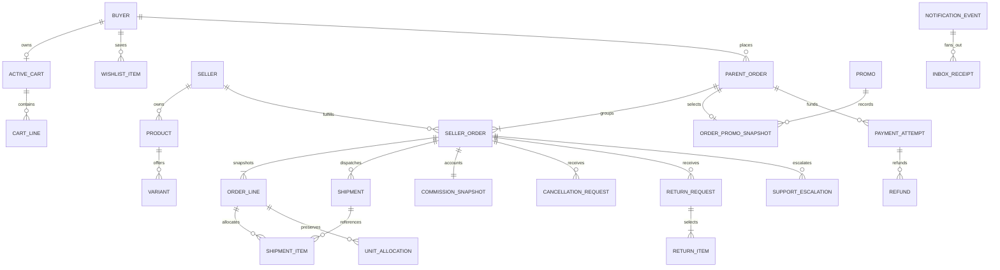

# BAZAR Commerce Domain Contracts — F19 target, not running API

Version1.0 / base `2057ecbb0e40b8866cf73a179e6153ecdd8110e9`. [Business Rules V1](BUSINESS_RULES_V1.md) governs approved behavior; [decision register](BUSINESS_DECISION_REGISTER.md) distinguishes AD approvals from TD technical proposals, PD business/finance, PL legal and EX provider gates. All names, field sets, API sketches, schema relations, job algorithms and machine states below are **proposed technical contracts**, not approved physical schema or implemented OpenAPI. No test fixture authorizes a legal/financial action.

## Shared contract envelope and authority

Continue existing validated success/error envelopes, bounded payload/time/response sizes, integer UAH minor-unit money and runtime input/output checks. Proposed metadata: `contractVersion`, `policyRevision`, `mode`, `version`, opaque resource IDs. Server derives actor/seller/owner from verified session and membership, never client `userId`, `sellerId`, price, discount, commission or status. A route seller reference is a lookup target, not authority. Cross-owner/tenant resources use indistinguishable not-found/denied policy without existence disclosure. Commands require exact Origin/CSRF/HttpOnly Secure SameSite BFF protections and current authorization (including revocation), not role labels in localStorage.

Mutations carry `expectedVersion` and scoped `idempotencyKey`. Persist `(actor, tenant, operation, key, canonicalPayloadDigest, resultRef, policyRevision)` uniquely with the effect. Same key/input replays original historical result; changed input conflicts. A historical receipt is not fresh availability, identity or pricing proof. Parameterized SQL, ordered locks and atomic writes protect owner+version+cap invariants. Retries after deadlock/serialization need bounded whole-transaction replay using the same key, never replay a remote payment call.

Proposed errors: `AVAILABILITY_CHANGED`, `CHECKOUT_STALE`, `PROMO_INVALID`, `PROMO_INAPPLICABLE`, `PRICING_POLICY_REQUIRED`, `PAYMENT_RECONCILIATION_REQUIRED`, `STATE_CONFLICT`, `AUTH_REQUIRED`, `NOT_FOUND`. Error identifiers/DTO changes need versioned client mapping before activation; existing error names remain unchanged in F19. Responses are no-store where actor/financial data is involved; no secret/PII/provider payload logging.

## Aggregate relationships and proposed additive storage

Diagram cardinalities describe a proposal: seller employees, shipment splitting/grouping and funding relationship require PD-09/EX-01 review. A shipment belongs to **one** seller order; no cross-seller parcel/tracking ownership. Return items reference purchased lines, never arbitrary live variant IDs. A logical multi-seller return may have a buyer group reference but each seller sees only their request. Parent payment→seller allocation and multi-capture feasibility remain EX-01/PL-03; diagram does not choose merchant-of-record or payout architecture.

Required integrity: unique active cart/buyer; unique buyer order public identifier; owner/seller composite FKs; child financial sum = parent; unique checkout completion; unique immutable line/unit identity; unique provider/account/environment/operation/event; sender event revision + recipient dedup; per-component preparation cycle deadlines; partial-return units/refund capacity cannot exceed purchased/paid entitlement. Quantitative stock tables/counters/reservations are **not** target entities. Purchase/return/shipment quantities are still validated unit counts.

New migrations only, checksum-protected as today. Plan additive seller/membership/availability, parent/seller-order/shipment/financial snapshot, return/deadline/outbox tables or reviewed extensions. Do not retroactively label ownerless legacy products as a real seller, turn test orders into real orders, or copy synthetic quotes into V1 money. Use an explicit legacy/test discriminator and reviewed mapping. Never edit migrations0001–0015; no migration is created in F19.

## Entity contracts

| Entity | Required target facts (proposed field names) | Owner/access | Idempotency and immutability |
| --- | --- | --- | --- |
| Cart | buyerId, active status/version, variant lines and requested quantities, live server price/availability annotations; no warehouse quantity | Buyer-only, trusted session; staff has no default cart access | Ensure-current once; actor command receipts; unavailable lines preserved, not auto-pruned |
| ProductAvailability | productId, owning seller, available/out-of-stock, revision, changedAt, actor, policyRevision; variant override pending PD-02 | Seller capability plus resource seller; public buyer read | True state transition increments revision; same retry/no-op produces no duplicate restored event; no quantitative decrement |
| ParentOrder | buyerId, unique publicOrderRef (format PD-06), checkoutId, line/seller refs, immutable financial/contact/delivery selection snapshot, separate derived aggregate labels | Buyer own; seller cannot read siblings or parent PII/financial totals by possession of child ID | Unique checkout completion+key; authoritative successful creation result immutable; events/status projections append-only |
| SellerOrder | parentId, sellerId, buyer ref, owned lines, net/discount/commission snapshot, preparation cycle/transition timestamp, own lifecycle/version | Owning seller scoped to fulfillment need; buyer via parent; assigned staff capability | Version/state guarded transitions; cancellation/deadline acts on component only |
| Shipment | sellerOrderId/sellerId, carrier, selected pickup point snapshot, allocated order-line quantities, own trackingRef, independent shipment state/evidence | Seller owns shipment; buyer own view; staff assigned purpose | Tracking uniqueness scoped carrier/account/service as actual provider permits, not assumed globally unique number; no TTN creation without EX-02 |
| Promo | server code, policy version, issuer/seller scope, eligibility selector, fixed/percentage definition, period/minimum/limits and funding configuration if approved | Only explicit campaign capability; seller may target own eligible catalog only | UNIQUE canonical code, auditable version updates; no client generation; category semantics/funding PD-02/03 |
| DiscountAllocation | orderPromo snapshot + eligible line/unit/seller identities, gross/eligible/discount/net, algorithm/tie-break/rounding revision | Backend-only writer, owner/redacted seller reader | Persist exact vector, immutable after success; sum/remainder proof below, no historical live re-evaluation |
| PaymentAttempt | parent/checkout identity, merchant/account/environment/adapter, server amount/currency/binding, operation key, status, authenticated evidence refs | Buyer own limited DTO; finance-specific service/admin grants | Persist operation before submit; one unresolved/successful attempt per payable plan; unknown blocks another charge |
| Commission | sellerOrderId, netMerchandiseMinor, rateBps=500, amountMinor, sellerProceedsBeforeOtherFees, calculation revision | Finance-specific write; own seller read; staff denied | Immutable initial snapshot; refunds/corrections append adjustment, no retrospective edit/retention assumption |
| CancellationRequest | sellerOrderId, buyerId, reason, requestedAt/version, owner/seller/staff action evidence/history | Buyer own creates; own seller processes post-threshold requests; assigned staff per grant | One effect per key, eligibility read under locked current seller-order state; request≠cancelled |
| ReturnRequest | buyer/sellerOrder refs, purchased line/unit quantities, reasons, evidence refs, communication/escalation/history | Buyer owns request; seller owns affected component; assigned staff | Unit entitlements locked across requests; no reset/reclaim after closure until approved legal policy |
| Refund | return/cancel/escalation cause, verified payment op, currency/amount and line-unit allocation, provider operation/status/evidence, audit | Trusted authorized finance workflow; buyer cannot specify executable amount | Capacity held for pending/unknown as well as completed claims; release only verified safe outcome+approved policy; confirmed requires provider proof |
| SupportEscalation | sellerOrderId, preparationCycleId, exact dueAt/escalatedAt/responseDueAt, staff queue/assignment, response/resolution refs | Assigned support staff; owning seller can respond; buyer sees scoped facts | Unique sellerOrder+cycle+reason; atomic case+job+event/audit; fail assignment routes to monitored staff queue, not silent discard |
| NotificationEvent | stable eventId/type/version, source aggregate/revision, occurredAt, provenance/mode, safe entity link, purpose, recipient eligibility snapshot | Internal emitter; owner inbox only; F13 notification store reused | Unique source revision/event; unique event+recipient; monotonic read cursor; push outbox respects consent, no fake delivery |

## Pricing and deterministic allocation contract

All arithmetic uses checked integers/rationals (BigInt intermediate); decimal percentage carried as approved basis points, not floating-point. Stored money remains integer minor units and currency-matched. No implicit Intl/Math.round finance. Let line gross `G_i = priceMinor_i * quantity_i`; eligible value `E_i` is server-derived under campaign/version; `E = Σ E_i`, gross `G = Σ G_i`. With one selected promo, target discount `D` is capped at E after the **approved** percentage/fixed calculation. Ineligible `E_i=0` implies `D_i=0`.

Required results:

- `0 <= D_i <= E_i <= G_i`; `Σ D_i = D`, `N_i=G_i-D_i`, `N=Σ N_i=G-D`.
- Unit vector `D_i,u` and `N_i,u` uses stable purchased-unit ordinal, sums exactly to each line; partial-return refund basis is those saved net units, not current prices or equal-share re-rounding.
- Seller `N_s=Σ own N_i`, `D_s=Σ own D_i`; sum seller values equals parent. Independently `C_s = approvedRound(N_s*500/10000)`, `P_s=N_s-C_s` before other approved fees. `Σ C_s` is parent commission; **do not replace with** rounded5% of parent N. No rounding stage is chosen here.
- Payment amount and refund entitlement must reconcile to approved merchandise/tax/fee policy. Carrier shipping is outside BAZAR calculation/payment basis under BR-S01; do not add synthetic shipping or treat missing fee as free delivery.
- Persist campaign identity/code/version, eligibility/category/variant snapshot, seller attribution, gross/D/net vector, commission/rate, policy/algorithm version, server pricing fingerprint and verified payment evidence. Mutable operational state may evolve by append-only events; successful original financial snapshot never changes.

### PD-01 alternatives — explicitly not selected

| Question | Alternative A | Alternative B | Requirement regardless of choice |
| --- | --- | --- | --- |
| Fractional percentage total | Round eligible aggregate once (half-up or half-even separately chosen) | Round each eligible line, then sum | Document arithmetic order/mode, test boundary values, cap and save version |
| Fixed/aggregate discount split | Proportional largest-remainder with canonical stable line key, then unit ordinal | Product/unit priority allocation with explicitly approved stable priority | Exact sum D, no negative line/unit, permutation-independent for same logical inputs |
| Commission | Independent seller half-up to minor unit | Independent seller half-even to minor unit (or explicitly approved floor) | Seller net = commission+proceeds; store rates and residuals; no parent-level redistribution |
| Partial quantity pennies | Save per-unit allocation vector at checkout | Save canonical deterministic unit assignment algorithm+inputs sufficient to reproduce exact vector | Multiple partial returns cannot refund more than full net entitlement; no changing assignment on retry |

Concrete non-approval examples: a101-minor-unit eligible subtotal at10% gives10.1minor units, so existing exact F5 blocks it; floor yields10, while some other inputs differ under half-up/half-even.5% commission on10minor units is0.5: half-up1 versus half-even0. Two independent sellers each net10 may yield commission2 under per-seller half-up, while parent5% of20 yields1; the recorded parent is the **sum of independently calculated sellers**, not a competing target. Fixed discount1 across two equal eligible1-minor lines requires assigning the1minor to a stable line/unit; neither choosing the first UI row nor random tie-break is acceptable. These examples demonstrate required decisions, not expected approved outputs.

Approved exact commission example (minor units): gross1,000,000; promo100,000; net900,000; commission45,000; seller proceeds855,000. A two-seller exact case with net900,000 and200,000 gives commissions45,000 and10,000 and proceeds855,000 and190,000; sums net1,100,000 =55,000 +1,045,000. This tests invariants only and does not select the method of discount allocation that produced those nets.

PD-01/02/03/04 block unsupported financial scenarios until resolved. Capping an oversized fixed discount is approved; shipping is excluded; stacking is forbidden. Zero net after valid cap must not fake a paid attempt—PD-04 defines separate proof before activation. Promo claim timing/release/funding cannot be inferred from immutable snapshots.

## Secure promo generation contract (TD-01)

1. Creation requires an authorized campaign capability, seller scope and safe limits; no public create route or accept-client-code endpoint. Seller cannot target another seller's product/category-funded budget without approved authority.
2. Generate11 unbiased decimal digits using Node crypto `randomInt(0,10)` repeated11 times; keep leading zeros, prefix literal uppercase `BZ`. Alternative unbiased CSPRNG rejection sampling may be reviewed. Do not use Math.random, modulo-biased bytes, timestamps or a sequential counter. Pattern `^BZ[0-9]{11}$` is target canonical storage/issuance format; input case/trim policy remains PD-03, not a silent change to F5 exact matching.
3. Attempt insert with unique code constraint inside transaction; retry collision in a new savepoint/transaction (PostgreSQL UNIQUE violation aborts an unguarded transaction). Retry count and request budgets are reviewed technical config; bounded exhaustion fails safely, never overwrites/recycles an old code.
4. Store issuer, scope, version, terms, activation and audit; authorization required for all changes. Old applied order snapshots retain the exact previous code/terms. Decide public code-retirement/reuse policy explicitly; proposed never-reuse namespace requires review.
5.10^11 possibilities are not authentication strength. Rate-limit probing/generation, uniform public rejection where needed, no code enumeration or contact/secret logs. Test deterministic RNG injection **only** in isolated tests to force collisions; no test path in production.

## Availability and saved-state/event contract

Target availability is seller-controlled binary state. Product vs variant inheritance is PD-02: alternatives are product state applies to all variants, or approved variant overrides with an explicit aggregate product display rule. Do not map numeric stock=1 into a new inventory quantity. Later migration may backfill binary state from historical stock>0 only under reviewed mapping/provenance; quantity limit checks against old stock must be retired in target paths rather than silently retained.

Availability commands use seller ownership, expected revision and key; same no-op/retry does not create an event. Under one transaction persist new state, transition revision and event/outbox. Availability-restored requires old out-of-stock→new available. Proposed recipients: union active authenticated cart owners and wishlist owners at a consistent transition eligibility cut; dedup by buyer and transitionID even if saved in both or multiple variants. Eligibility cut/account deletion/notification preferences and lawful basis require PL-02/PD-02; retries reuse saved eligible recipients rather than rediscover an enlarged set. A second genuine out-of-stock→available transition is a distinct event, not accidentally suppressed forever by `(user,product,type)` uniqueness.

Reuse F13/F17 inbox. Proposed additional versioned type `product.availability_restored` (not yet in schema), no independent notification store. Event payload holds product ID/handle link, source revision, test/live provenance, minimal text—not phone/token. Deep links use allowlisted same-origin route builder and owner checks for private entities; no open redirects. In-app insert and source event commit atomically. Push is separate consent-checked outbox delivery; acceptance/queueing is not delivery. No stock-reservation event/notification is required.

Cart reads preserve unavailable entries with disabled controls/«Немає в наявності» and authoritative current price/status; explicit remove remains available. Whether to block whole checkout or purchase a buyer-selected available subset is PD-05. Any chosen path must leave unavailable/unpurchased entries intact and revalidate availability before confirmation, without quantitative stock locking/decrement. Changes between payment and order commit need safe reconciliation/refund review, not invented automatic compensation.

## Parent/seller order and cart completion contract

Proposed sequence: server freezes owned selected lines and seller/price/availability/promo/contact/location revisions → acknowledges plan → prepares durable payment operation → verifies provider result → atomically creates/finalizes successful parent+seller components, immutable financial/payment snapshot, history, promo claim under approved lifecycle and purchased-cart completion receipt. A pre-payment checkout/payment intent is not a successful order. Payment success before DB commit is a real distributed gap: retry/reconcile same operation without charging again; do not clear cart on browser assertion or compensate by unapproved refund.

PD-04 chooses zero-payable proof; PD-05 chooses concurrent edits/cut. Possible reviewed approaches are locked/frozen selection with deferred mutations, version conflict followed by reconciliation, or safe subtraction by immutable selected-line versions. No option may erase subsequently added/unpurchased/unavailable items. Exact completion replay returns same parent/seller refs and cannot clear again. Successful cleared selection permits a second purchase with a **new payment cycle**; existing UNIQUE(cart_id) test intent guard must not be copied to permanently block the account's future purchases. Failed/unknown charge preserves cart and operation. One active cart policy remains, but whether to reuse cleared cart or rotate it is technical/PD-05 review.

Each shipment gets its own provider tracking identity; no one parent tracking field. Split shipment quantities, partial seller fulfillment and parent aggregate labels need PD-09/06. A sibling seller order never changes because another was cancelled, escalated, returned or refunded. Parent monetary/operational view aggregates facts without overwriting them. No BZ promo format assigned to order IDs.

## Cancellation and lifecycle state contracts

Target seller-order labels/technical codes below express the approved buyer-action policy, not the current limited SQL status enum. Core expected path New→Confirmed→Preparing→Shipped→In transit→Delivered→Completed requires explicit authorized transition evidence (PD-07/EX-02) before implementation; no caller may submit arbitrary status. Terminal cancellation labels are separate from payment/refund axes.

| Locked seller-order state | Buyer action approved | Responsible processing | Forbidden inference |
| --- | --- | --- | --- |
| New / `new` | Direct cancellation | Buyer own command; audit state/version+event | Cancellation does not confirm a financial refund |
| Confirmed / `confirmed` | Direct cancellation | Same owner/state guard | Seller-start-preparation race cannot bypass cutoff |
| Готується до відправлення / `preparing` | Cancellation request only | Owning seller processes; staff/legal escalation as required | No direct buyer state update |
| Shipped / `shipped` | Cancellation request only | Own seller; carrier interception separately verified | Seller approval is not proof parcel stopped or returned |
| In transit / `in_transit` | Cancellation request only | Own seller; escalation/legal rights preserved | No automatic undo of shipment or money |
| Delivered / `delivered` | Return procedure | Owned item-level return under PL-01 | No direct cancellation shortcut |
| Completed / `completed` | Return procedure | Same legal entitlement gate | “Completed” does not waive statutory rights |
| Cancelled / `cancelled`; Скасовано системою / `system_cancelled` | Replay/history/status, any further remedy per legal policy | Idempotent evidence-preserving workflow | No automatic refund success or sibling cancellation |
| Повернено / `returned` | Applicable verified uncollected-return resolution | Carrier facts+seller/staff, legal financial resolution | Does not assert merchandise inspection, buyer fault or refund completion |

Proposed cancellation request graph: requested→under_review→approved/declined; withdrawal/reopen/time limits pending PD-07/PL-01, blocked rather than invented. Approved is a request decision, not an automatic shipment/financial state transition; execute allowed seller-order transition as a separately correlated command under current state. Direct cancellations audit owner/key/state once even with retries. For a parent containing mixed seller states expose per-component action; “cancel all” atomicity/partial success needs explicit policy, not silently cancelling siblings.

Five independent status axes remain: seller/parent order, payment, shipment, merchandise return, financial refund. Immutable events carry previous/new state, actor capability/scope, source/evidence, reason, server timestamp, key and policy version; corrected observations append, never edit past events.

## Deadline, escalation and race protocol

BR-D01 starts from exact authoritative server-recorded Preparing transition, **not** order creation, browser time, midnight or job pickup. Persist `preparationCycleId`, `preparedAt`, calendar policy/zone revision and computed `dispatchDueAt`. Store UTC `timestamptz`; render dates in reviewed IANA zone. Do not recompute old deadlines on later timezone-policy changes.

PD-08 calendar alternatives: (A) add5 calendar dates in approved zone preserving local transition wall-clock time (e.g. Europe/Kyiv **proposed**, not assumed), then convert to UTC; explicit DST gap/overlap resolution needed; (B) add5 dates in UTC at same UTC time. Adding120elapsed hours across DST is not automatically equivalent to A; end-of-day-five-days is not approved. Until zone/DST/boundary convention is decided the automation gate stays disabled. Tests must include both DST changes, leap/month/year crossings and exact boundary ±1ms. Proposed due comparison `now >= dueAt` and dispatch cutoff equality are technical choices requiring PD-08 review, not secretly selected.

Proposed durable job algorithm (TD-03):

1. Select due component/cycle with lease/retry control; lock seller order then linked escalation using one documented global lock order. Recheck version/cycle, current cancellation/delivery/dispatch evidence and effective policy. A stale job has no effect. Scheduler lag does not move the original dispatch deadline.
2. If dispatch still not confirmed under approved cutoff/proof, atomically create unique escalation + staff queue/assignment + seller inbox/outbox + audit and `escalatedAt` (server timestamp). Set `responseDueAt = escalatedAt +48elapsed hours`; retries never extend it. Persist channel delivery failures/retry separately; failure to notify is not fake delivery or permission to change the timer silently. Legal treatment of delivery outages remains PL-01/PD-08.
3. Response transaction locks the same scope and records sender/authority/content/provenance and first qualifying `respondedAt`. A response leaves unresolved case open for assigned staff; it cannot set shipment confirmed or close the case on its own.
4. At response deadline lock/recheck same cycle/case, verified dispatch, qualifying response and order state. If no response and no superseding verified dispatch/remedy, exactly once system-cancel **only affected seller order**, record refund-workflow intent, notify buyer/seller and audit. Refund remains pending policy/provider proof; cancellation never fakes money returned.
5. If response exists but unresolved, keep open for staff. Additional escalation/closure SLA is not invented. Staff unavailability uses monitored queue; no optional unassigned case lost silently.

Dispatch/response/deadline jobs serialize on same component. If evidence arrives late, record both carrier occurredAt and server verifiedAt. PD-08 must choose eligibility cutoff and handling of late proof/response, including evidence that actually preceded the deadline but was delayed. Until resolved ambiguous destructive race must be routed to staff and automation blocked for that case. A system-cancelled order is not silently resurrected by a late webhook; corrected logistics may need reconciliation/refund review. Re-entering Preparing must not reset timer by retries/toggling; legitimate new cycle/reopen authority is PD-08. Job crash, worker lease expiry, duplicated events and unrelated seller components require explicit tests.

## Shipping contract — no BAZAR tariff calculator

The order-facing selection contains carrier enum, opaque city/point refs, point kind where carrier supports it, safe display/address snapshot, directory verification provenance/time and per-seller shipment association. No client shipping amount, invented carrier fee, BAZAR estimate/TTL or parcel-price planner is required for V1 checkout. Display exactly: **«Вартість доставки згідно з тарифами поштового оператора»**. Missing BAZAR shipping amount is “handled by operator”, not0UAH/free. Amount field omission/discriminated `carrier-managed` status must be versioned, not silently set to null in clients expecting integer quotes.

Validate selected pickup point availability before order confirmation using approved directory contracts. After successful order, location loss produces owning-seller notice/task; seller contacts buyer for agreed replacement. Preserve original snapshot; append amended destination/consent/provenance with version. Never silently reroute parcels or collect real TTN/PII through tests. Each seller shipment tracking belongs to authorized seller; full/partial split and mutation policy pending PD-09/EX-02.

An authenticated carrier return event for non-collection maps only the affected shipment and applicable seller-order state to «Повернено». Keep independent merchandise inspection/return/refund states. Create financial-resolution case, not a financial success. Verify event carrier/account/tenant/tracking/env and dedup; unverified buyer/seller assertion is not an official return. Shipping liability/refund/commission treatment stays PL-01/03.

## Payments, refunds and commission ledger

Proposed normalized payment graph reuses F8 guard shape: prepared/submitting→pending/unknown→verified succeeded or definitively declined/cancelled. Provider-specific authorize/capture/settled finality is EX-01; do not claim success based on generic “authorized” label. Store durable operation/reference before remote submit, bind amount/currency/account/environment and plan fingerprint; inspect/reconcile same op on uncertainty. A declined terminal attempt permits a new attempt only when provider contract establishes no remaining charge and plan remains valid. Cancel request is not remote cancellation proof. Duplicate webhook `(provider,account,environment,eventId)` with same digest is replay; different payload conflicts/quarantines. Authenticated raw bytes verified before parsing; no client success endpoint.

Refund graph proposed: requested/policy_blocked→approved/prepared→submitted/pending/unknown→provider_confirmed or definitive_rejected. Exact names/approval authority reviewed before schema. Buyer request cannot post executable amount; server derives actual discounted unit entitlement under approved allocations/legal policy. Reserve pending/unknown refund capacity conservatively against verified paid amount and relevant line/unit entitlement; lock shared payment/capacity and seller request. Full/partial across sellers cannot exceed captured capacity or refund same unit twice. Rejection releases capacity only when provider certainty and approved rule allow. Late/contradictory events require reconciliation, not terminal overwrites.

Confirmed provider evidence updates refund financial projection and emits verified refund event atomically with audit/inbox/outbox. Request/approval/submission means no “funds returned”. Shipment interception, physical return/inspection and refund are separate. Commission5% snapshot is not a reason to deduct from buyer refund; PL-03 retention preference cannot become an irreversible fee, seller debt or payout adjustment. Ledger distinguishes buyer refund obligation, provider cash movement, seller net obligation, commission adjustment and processing charges; settlement, tax/fees, funding and payouts are pending. Append reconciling adjustments; never mutate original order net/commission to match later live prices.

## Proposed RBAC and tenant-isolation matrix (TD-05, review required)

Legend: O=own buyer resources; T=own seller tenant and explicit capability; A=assigned staff responsibility+purpose; E=explicit sensitive grant/approval only; D=deny; P=pending/disabled. Role name alone does not grant any E. Seller employee remains P until PD-09 approves scope, delegated subset and revocation. No impersonation or admin customer directory.

| Capability | Buyer | Seller | Seller employee | Support | Moderator | Administrator |
| --- | --- | --- | --- | --- | --- | --- |
| Own profile/address/cart/wishlist | O | O only when acting as buyer | P | D | D | D |
| Product/category publication, price, availability | Public read | T own products; global taxonomy permission separately reviewed | P | D | A moderation only, not price/bank changes | E catalog administration |
| Create/edit eligible promo | Apply only | T own eligible scope, PD-02/03 | P | D | D | E campaign scope |
| Order details/fulfillment contact | O parent | T own component, minimum necessary PII | P | A case-linked minimal view | A only moderation need, otherwise D | E operational need, not blanket PII |
| Seller order/shipments/cancel requests/returns | O buyer actions only | T own allowed state actions | P | A escalation; cannot overrule law or invent shipment | D unless separately assigned moderation decision | E reviewed operational scope |
| Ticket/chat reply/assignment | O member/owner | T genuine membership only | P | A queue/case | A moderation action only | E assignment management |
| Refund initiation/approval/settlement | Request only | Request/own evidence, execution P pending policy | P | Escalate/request only, no money execution | D | E finance-specific and PL-03, not default admin |
| Seller bank details / payout destination | D | P verified change workflow, PL-03 | P | D | D | E separately verified sensitive workflow |
| System settings / role grants / secrets | D | D outside own reviewed tenant settings | P | D | D | E least privilege, no self-elevation |
| Notification prefs / inbox | O | Own account inbox | P | No arbitrary customer impersonation | D | E source/template configuration only |

Every read/write validates authenticated principal, requested tenant/resource owner, current grant/scope, assignment, allowed state and version. Proposed composite FKs supplement but never replace service auth; evaluate RLS separately for pool/session safety. Cross-role tests: sellerA cannot reference sellerB product/price/promo/order/shipment/return IDs; buyerA cannot read buyerB cart/order/message/inbox; stale/revoked employee/staff grant denied; support cannot edit bank/settlement/settings; moderator cannot approve refund; admin without explicit finance permission denied; mixed-role user must select valid context, not union unrelated powers. Assignment changes/races are audited and rechecked at commit.

## Personal-data, evidence and recovery contracts

Approved profile fields do not approve plaintext storage. Phone normalized lookup and recoverable encrypted contact are separate concerns; F4 currently stores keyed digest only and constant mask. First/last name currently exist, patronymic/email require reviewed optional fields. Order-recipient contact is collected for an order without compulsory saved profile address; use purpose-limited encrypted snapshot/ref with retention policy, not unsafe browser draft. Saved address requires explicit save; order history preserves lawful transaction evidence without leaking an address to other sellers.

PL-02 must define per-field purpose/legal basis, access, encryption/key custody/rotation/backups, consent/preferences/version, deletion/anonymization/legal hold and recovery (lost/reassigned phone, session revocation, verified change). No actual retention duration or blanket “consent for everything” is approved. On account deletion stop optional delivery, revoke sessions/targets, address cart/wishlist deletion while protecting lawfully retained financial history; resolve legal precedence before automated deletion. Logs/audit use opaque refs and safe reason enums, not raw phone/email/address/promo/evidence.

Photos/supporting evidence require private storage, owner/tenant checks on upload/read, reviewed MIME/size limits, content sniffing/malware scan/quarantine, expiring authorized retrieval and deletion policy. No public upload enabled by this contract. Notifications disclose minimal data, respect preferences/consent again at dispatch, and safe links reauthorize on destination. Recovery cannot be a staff bypass or local demo flag; no real SMS/provider activation.

## Existing implementation conflicts and migration boundary

Evidence inspected at base, **not modified in F19**:

| Current evidence | Conflict with target V1 | Future change / gate |
| --- | --- | --- |
| [0001 core](apps/api/migrations/0001_core.sql), [0002 indexes](apps/api/migrations/0002_version_indexes.sql), [catalog](apps/api/src/business/catalog.ts), [cart](apps/api/src/business/cart.ts), [checkout state](apps/api/src/checkout/state.ts) | Numeric variant stock/min-stock checks/fingerprints; no seller attribution | F20 additive binary availability + seller ownership plan and versioned DTO; F21/F22 retire stock prerequisites on target paths. No inventory reservation/decrement requirement |
| [F5 pricing](apps/api/src/promotions/pricing.ts), [promotion service](apps/api/src/promotions/service.ts), [0005](apps/api/migrations/0005_promotions.sql) | One-line exact arithmetic, product allowlist; oversized fixed rejects, free scenario blocked; arbitrary test codes | F22 cap/multi-line/category/code-creation contracts, after PD-01/02/03/04 decisions; never relabel legacy synthetic codes as V1 campaigns |
| [shipping service](apps/api/src/shipping/service.ts), [F9 integration](apps/api/src/integration/checkout.ts), [test pricing](apps/api/src/payments/test-pricing.ts), [F16 sidecar](apps/api/migrations/0014_discounted_test_checkout.sql) | Required synthetic quote freshness and merchandise+shipping payment basis | New carrier-managed selection/charge basis; no quote/TTL or tariff addition to V1 checkout; old test evidence unchanged. Migration/client discriminator required |
| [0001 orders](apps/api/migrations/0001_core.sql), [F6 snapshot](apps/api/migrations/0006_checkout_orders.sql), [checkout contracts](apps/api/src/contracts/checkout.ts) | Parent-only owner model, pending/unpaid test-only order; no seller split, commission, display-ID policy | Add parent/seller/shipment/commission relations and immutable new-version snapshots; no fictitious paid upgrade/backfill |
| [payment guard](apps/api/migrations/0009_payment_security.sql), [cart receipts](apps/api/migrations/0010_current_cart_checkout.sql) | UNIQUE cart payment scope and no completion clearing restrict second purchase | New payment-cycle/completion identity and safe clearing receipt; preserve unknown-payment dedup/owner/CSRF. Reusing same cart must not bypass charge guard |
| [lifecycle service](apps/api/src/lifecycle/service.ts), [0013](apps/api/migrations/0013_order_lifecycle.sql) | Request-only/closed-for-test states, no buyer direct cancellation or seller/state/deadline model | F23 +F25/F26 reviewed authorities/jobs/events; do not mislabel technical test closure as approved cancellation/refund |
| [customer contracts](apps/api/src/contracts/customer.ts), [customer service](apps/api/src/customer/service.ts), [browser screen](apps/storefront/browser-integration/screen.tsx) | Opaque saved-address requirement/read-only synthetic contacts, no optional patronymic/email live store | F21/F24 optional profile address and checkout-specific contact snapshot under PL-02; never invent live phone from digest |
| [notification store](apps/api/src/communication/notifications.ts), [0012](apps/api/migrations/0012_communication_foundation.sql), [0015](apps/api/migrations/0015_notification_center.sql) | No availability-restored type; `(user,kind,source_id)` must identify transition not eternal product | Add event revision and recipient dedup to existing F13 inbox; new type/source not second system; consent/outbox gate remains |
| [money display](apps/storefront/lib/money.ts), [provider](apps/storefront/services/service-provider.server.ts), [profile](apps/storefront/components/account) | Whole-hryvnia rounding and mock-only ordinary UI; UI not real backend authorization | F20 exact display, F21/F24 guarded versioned adapters in approved test mode, preserve design; no claim current screens implement V1 |
| [PG tests](apps/api/tests/integration/postgres.test.ts), [browser checkout](tests/e2e/browser-tests/checkout.spec.ts), [notices](tests/e2e/browser-tests/notifications.spec.ts) | Existing tests prove old bounded stock/quote/single-line synthetic protocol | Keep historical evidence; later additive/new-version tests verify new rules and explicit retired-contract behavior. F19 does not change tests to make rules appear implemented |

ADR0001–0016 remain historical implemented technical boundaries. [ADR0017](docs/adr/0017-business-rules-commerce-target.md) records target supersession only. Runtime main stays fail-closed for private commerce; no new routes/config/migrations are activated in F19.

## F20 implemented contract delta

[ADR0018](docs/adr/0018-catalog-binary-availability.md) and [acceptance](docs/F20_CATALOG_ACCEPTANCE.md) supersede product-vs-variant availability proposals only. `catalog_products.selectable` chooses per-variant aggregate vs own product boolean, and `catalog_variants` references unchanged legacy variant/product IDs. Published simple products have one canonical purchasable variant, selectable products at least one. No stock value is imported as binary truth.

New `/api/v1/catalog/products`, `/products/{reference}`, `/categories` and protected test-only `PATCH /api/v1/catalog/seller/products/{id}` are implemented with contractVersion2 reads, strict typed client and optional non-production read-only preview. New migration0016 changes no existing SQL file. Identity/price/availability/media/query/event details and bounds are documented in acceptance/OpenAPI. No fake seller assignment of legacy rows. Catalog V2 public projections omit real ratings/vendor metadata unless attributes provide it; price selection is explicit for differently-priced variants, aggregate sorting policy is still pending.

Canonical product/variant updates commit guarded audit/command receipts and F13 notifications. Media is supported, not a claim approved licensed assets were supplied. Full ordinary server cart/account UI, provider activation and production-scale query/index/role review remain separate. Historical F19 diagrams and future financial/cancellation/state proposals do not become implemented by this delta.
