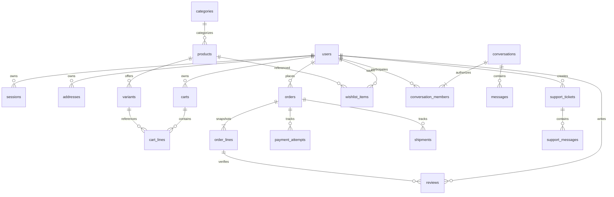

# PostgreSQL architecture — F1 design, not an active database

PostgreSQL is not connected to either application. There is no database driver, ORM, migration runner or applied business schema in F1. DB-001 remains future implementation work. The optional [Compose file](../infra/postgres/compose.yaml) starts an empty, free local PostgreSQL 17 instance only; it is not an application dependency or production deployment.

## Entities and ownership



Additional tables: `otp_challenges` (keyed hashes, counters, expiry/consumption; not plaintext codes), `idempotency_records`, `provider_events` (verified webhook IDs and normalized outcomes), `delivery_quotes` and eventual attachment metadata/quarantine records. Category hierarchy uses `parent_id`; user phone identifiers need normalized uniqueness and an explicit encryption/lookup strategy before storage.

Use UUID primary keys and `timestamptz`. Every owned resource has a non-null user foreign key or an explicitly designed guest identity; the server sets it. Message membership has unique `(conversation_id,user_id)`, participant-scoped `last_read_message_id` and pin state. Do not model unread count as the sum of unread messages. Support history is separate from marketplace conversations so staff/customer access policies can evolve independently.

Catalog ownership/Shopify import and seller tenancy are unresolved. Do not invent seller privileges or copy Shopify fixture IDs into authoritative keys. Product variants carry unique SKU, inventory/version and pricing; order lines retain immutable commercial snapshots so later product/address edits cannot rewrite order history.

## Constraints, indexes and transactions to implement in DB-001

- Foreign keys enforce ownership references. Use restrictive deletion for orders/payment/audit history; define retention and anonymization before cascading user deletion. Soft-delete only where product/legal semantics require it.
- `CHECK amount_minor >= 0`, explicit currency, integer quantities with approved bounds and nonnegative inventory. Calculate authoritative totals with integer arithmetic inside transactional service boundaries. Unknown payment outcomes remain explicit.
- Unique `(user_id,product_id)` wishlist items; a partial unique index on `addresses(user_id) WHERE is_default`; unique variant SKU and category/product handles. Validate category cycles in the service/transaction layer.
- Index orders `(user_id,created_at,id)`, messages `(conversation_id,created_at,id)`, memberships `(user_id,conversation_id)`, support tickets `(user_id,created_at,id)` and foreign keys used in joins. Define Ukrainian full-text search separately with representative query tests.
- Bound OTP attempts/resends atomically; consume a challenge once and revoke/rotate sessions transactionally. Store hashed session tokens, never raw cookies; use separate least-privilege credentials and expiry cleanup.
- Durable unique idempotency scope `(actor_id,operation,key)` plus request hash/result; unique provider event ID and `(conversation_id,sender_id,client_message_id)` prevent duplicate side effects. Never infer successful payment from a browser redirect.
- Inventory reconciliation/order placement, default-address changes and read-cursor advancement require transactions and concurrency tests. Define state transitions and locking before implementing writes.

## Forward migration policy

1. Commit numbered immutable SQL migrations (`0001_...sql`, etc.) with checksums and a schema-version table once a real schema is reviewed. Do not edit an applied migration.
2. Use one migration job with an advisory lock. Application startup must not auto-create or auto-migrate production tables. Run migrations with a separate owner role; runtime roles get only required grants.
3. Test from an empty disposable database and a supported previous snapshot; verify constraints, rollback of failed transactions, duplicate requests, concurrent writers and indexes. There are no migrations to apply/test in F1.
4. Prefer expand/backfill/contract: add nullable fields or parallel tables first, deploy compatible readers/writers, backfill in bounded batches, then enforce/drop in a later release. Nontransactional concurrent index creation needs a separately documented migration.
5. Destructive data migrations, real imports and production credentials need separate approval. Use synthetic seeds only. Roll forward with corrective migrations; rehearse backup/restore and release rollback rather than blindly reversing financial history.
6. Before operational use, define encrypted backups, retention, restore verification, recovery objectives, monitoring, connection-pool limits and ownership. F1 claims none of these are operational.

## Optional local database

Docker is not needed to build/test/run F1. If developing DB-001 locally:

```sh
export BAZAR_POSTGRES_PASSWORD="$(openssl rand -hex 24)"
docker compose -f infra/postgres/compose.yaml up -d
# Optional local psql: host 127.0.0.1, port 5432, user/database bazar_local.
docker compose -f infra/postgres/compose.yaml down
```

Do not commit the generated password or real data. The volume survives `down`; deleting volumes is an explicit local data-removal operation. The image follows a local-development major tag; pin a reviewed patch/digest and vulnerability baseline before any release. No API DATABASE_URL is consumed in F1, and `/ready` does not probe or claim PostgreSQL availability.
