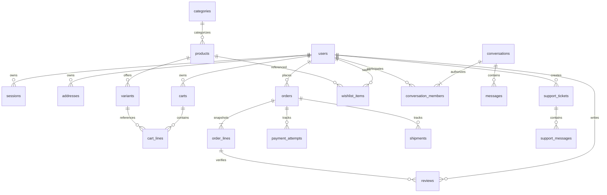

# PostgreSQL architecture — Phase F2 foundation

Phase F3 update: migration 0003 adds the simple-token catalog search GIN index. Public catalog handlers now read products/categories/variants; cart persistence is internal and HTTP remains authentication-blocked. See [ADR 0003](adr/0003-catalog-cart-boundaries.md). Historical F2 privileges below are extended by the explicit read-only catalog grants at the end.

Historical F2 baseline: Phase F2 implements the reviewed technical schema in `apps/api/migrations`, an explicit migration runner, a bounded `pg` pool and database-aware readiness. All business HTTP routes remain absent and the storefront stays on mocks. The local [Compose file](../infra/postgres/compose.yaml) binds only 127.0.0.1; the separate [test Compose file](../infra/postgres/compose.test.yaml) uses a random loopback port, generated credentials and tmpfs. No hosted database or real data is used.

[ADR 0002](adr/0002-postgresql-foundation.md) records unresolved phone/recipient encryption, guest-cart, staff/seller, financial-transition and retention decisions. Schema existence is not authorization or production readiness.

## Entities and ownership



Additional tables: `otp_challenges` (keyed hashes, counters, expiry/consumption; not plaintext codes), `idempotency_records`, `provider_events` (verified webhook IDs and normalized outcomes), `delivery_quotes` and eventual attachment metadata/quarantine records. Category hierarchy uses `parent_id`; user phone identifiers need normalized uniqueness and an explicit encryption/lookup strategy before storage.

Use UUID primary keys and `timestamptz`. Every owned resource has a non-null user foreign key or an explicitly designed guest identity; the server sets it. Message membership has unique `(conversation_id,user_id)`, participant-scoped `last_read_message_id` and pin state. Do not model unread count as the sum of unread messages. Support history is separate from marketplace conversations so staff/customer access policies can evolve independently.

Catalog ownership/Shopify import and seller tenancy are unresolved. Do not invent seller privileges or copy Shopify fixture IDs into authoritative keys. Product variants carry unique SKU, inventory/version and pricing; order lines retain immutable commercial snapshots so later product/address edits cannot rewrite order history.

## Implemented integrity and remaining transactional services

- Foreign keys enforce ownership references. Use restrictive deletion for orders/payment/audit history; define retention and anonymization before cascading user deletion. Soft-delete only where product/legal semantics require it.
- `CHECK amount_minor >= 0`, explicit currency, integer quantities with approved bounds and nonnegative inventory. Calculate authoritative totals with integer arithmetic inside transactional service boundaries. Unknown payment outcomes remain explicit.
- Unique `(user_id,product_id)` wishlist items; a partial unique index on `addresses(user_id) WHERE is_default`; unique variant SKU and category/product handles. Validate category cycles in the service/transaction layer.
- Index orders `(user_id,created_at,id)`, messages `(conversation_id,created_at,id)`, memberships `(user_id,conversation_id)`, support tickets `(user_id,created_at,id)` and foreign keys used in joins. Define Ukrainian full-text search separately with representative query tests.
- Bound OTP attempts/resends atomically; consume a challenge once and revoke/rotate sessions transactionally. Store hashed session tokens, never raw cookies; use separate least-privilege credentials and expiry cleanup.
- Durable unique idempotency scope `(actor_id,operation,key)` plus request hash/result; unique provider event ID and `(conversation_id,sender_id,client_message_id)` prevent duplicate side effects. Never infer successful payment from a browser redirect.
- Inventory reconciliation/order placement, default-address changes and read-cursor advancement require transactions and concurrency tests. Define state transitions and locking before implementing writes.

## Forward migration policy

1. Commit numbered immutable SQL migrations (`0001_...sql`, etc.) with checksums and a schema-version table as reviewed immutable files. Do not edit an applied migration.
2. Use one migration job with an advisory lock. Application startup must not auto-create or auto-migrate production tables. Run migrations with a separate owner role; runtime roles get only required grants.
3. Test from an empty disposable database and a supported previous snapshot; verify constraints, rollback of failed transactions, duplicate requests, concurrent writers and indexes. F2 tests fresh databases, the 0001 → 0002 upgrade, concurrent/rerun behavior, checksum mismatch, unknown history and atomic failure rollback.
4. Prefer expand/backfill/contract: add nullable fields or parallel tables first, deploy compatible readers/writers, backfill in bounded batches, then enforce/drop in a later release. Nontransactional concurrent index creation needs a separately documented migration.
5. Destructive data migrations, real imports and production credentials need separate approval. Use synthetic seeds only. Roll forward with corrective migrations; rehearse backup/restore and release rollback rather than blindly reversing financial history.
6. Before operational use, define encrypted backups, retention, restore verification, recovery objectives, monitoring, connection-pool limits and ownership. F1 claims none of these are operational.

## Optional local database

Docker is needed for `npm run test:integration`, which creates and removes only its own disposable project. For optional persistent local development:

```sh
export BAZAR_POSTGRES_PASSWORD="$(openssl rand -hex 24)"
docker compose -f infra/postgres/compose.yaml up -d
# Optional local psql: host 127.0.0.1, port 5432, user/database bazar_local.
docker compose -f infra/postgres/compose.yaml down
```

Do not commit the generated password or real data. The volume survives `down`; deleting volumes is an explicit local data-removal operation. Both Compose files pin the reviewed PostgreSQL 17 image digest. F2 consumes DATABASE_URL only in the API, never in Next.js. /ready checks PostgreSQL connectivity, schema history and checksums; it does not claim business modules are ready.

## Controlled migration and runtime roles

Supply `MIGRATION_DATABASE_URL` using a local environment/ignored `.env.local`; run `npm --prefix apps/api run db:migrate` explicitly. API startup never invokes it. The migration login must own the target database/schema; do not give its credentials to the API. The CLI refuses production mode. Each SQL file is transactional; do not add transaction-control statements or nontransactional/concurrent-index operations to this runner. Applied files must never be edited. Future nontransactional migrations need a separate reviewed mechanism.

Provision a separate login with a password prompt (`createuser --pwprompt --no-superuser --no-createdb --no-createrole bazar_api`) using your local owner connection. Passwords and connection URLs must stay out of Git, command output and logs. As owner, grant only:

```sql
GRANT CONNECT ON DATABASE bazar_local TO bazar_api;
GRANT USAGE ON SCHEMA bazar_meta TO bazar_api;
GRANT SELECT ON bazar_meta.schema_migrations TO bazar_api;
```

Set API `DATABASE_URL` to that login, not the migration owner. No grants to business tables are needed because F2 has no business API. Production readiness rejects elevated roles and writable migration history. Add the least privileges needed by each future module only after its authorization/transaction model is reviewed.

Local loopback TCP may use `DATABASE_SSL=disable`; remote hosts and production require `verify-full` with certificate verification. Use the system/Node trust store for a reviewed private CA, never `rejectUnauthorized:false`. URL query overrides such as `sslmode=disable` are rejected. `DATABASE_TIMEOUT_MS` bounds connection/statement time and a client query deadline; the pool is capped at four connections and closed after HTTP shutdown. Do not change PostgreSQL int8 parsing globally: money returns as strings and must be range-checked before conversion to storefront integer minor units.

`npm --prefix apps/api run test:integration` requires the local Linux Docker socket. It generates an isolated project, password and loopback port, creates synthetic case databases, and tears them down in finally. It refuses non-test database targets. The suite verifies the schema, keys/checks, upgrades/reruns/concurrent migrations, rollback/checksum protection, restricted runtime credentials, real /ready behavior and compiled-process cleanup. No production volume is mounted or reset.

## Phase F3 runtime privilege addition

After separate role provisioning and the usual F2 metadata grants, add only read-only catalog access as owner:

```sql
GRANT USAGE ON SCHEMA bazar TO bazar_api;
GRANT SELECT ON bazar.products, bazar.categories, bazar.variants TO bazar_api;
```

Integration tests verify catalog reads with those restricted credentials and deny cart reads and price writes. Do not grant cart/user/session/financial access to the catalog runtime. Internal cart tests run with disposable test-owner credentials; no production cart role or session policy is activated. Existing migrations 0001/0002 remain immutable. The suite now upgrades 0001 through 0003 and rehearses repeat/concurrent execution and failed next migration rollback.
